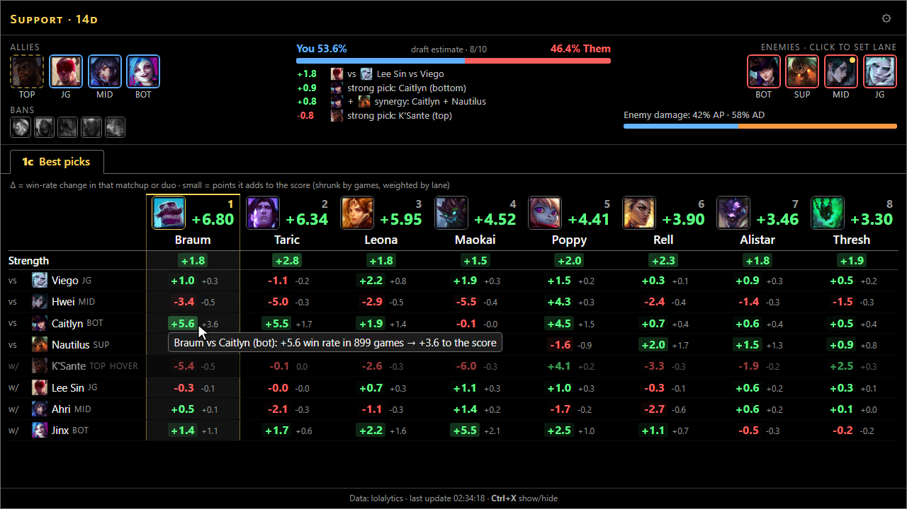
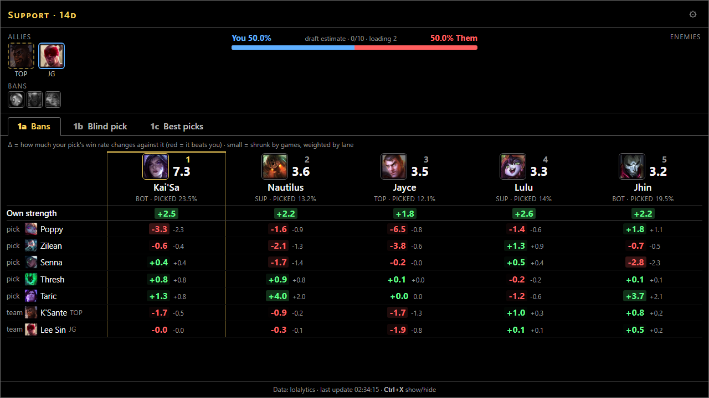
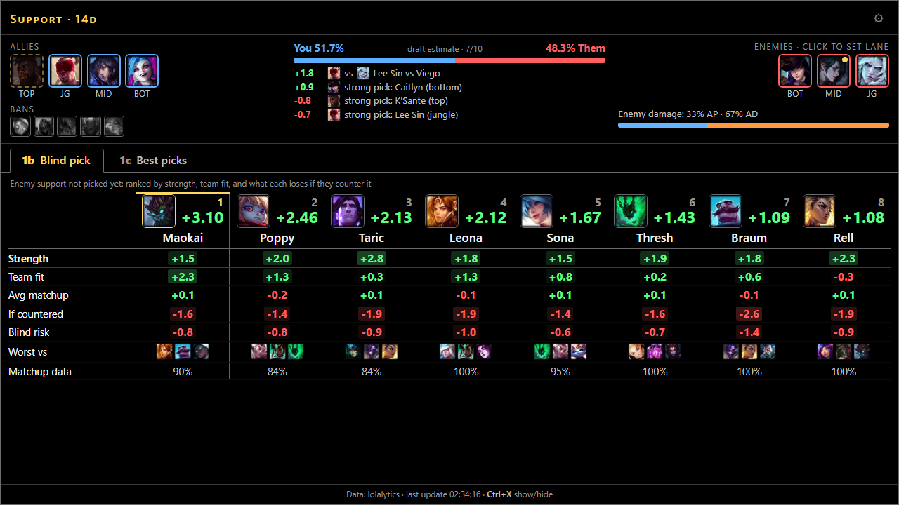
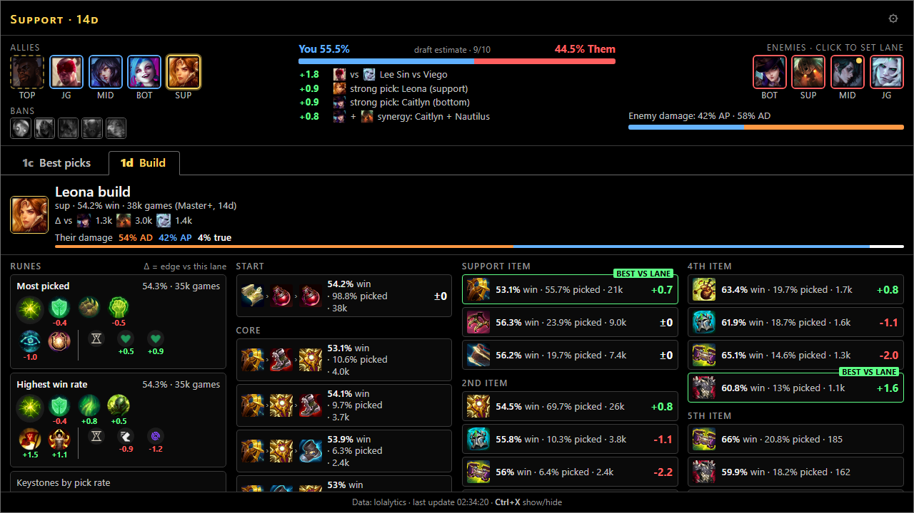
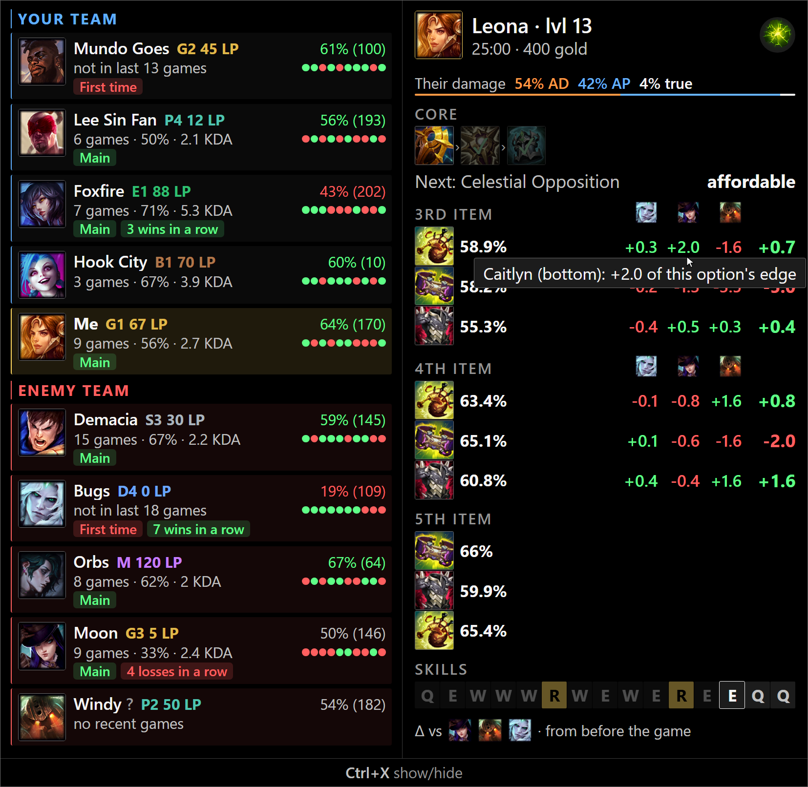
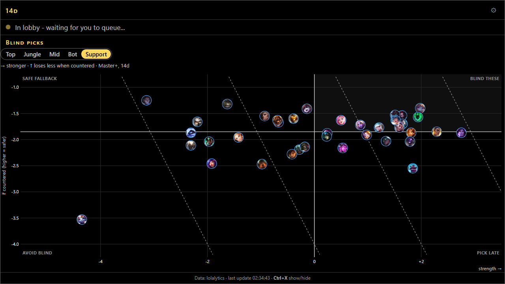

# LoL Companion

A window that ranks your best picks in champ select, using matchup and synergy stats, your team and
theirs, and your own record. It is one 16:9 window that shows the blind-pick explorer between games
and bans, picks and build as the draft moves on; in game, a second window over the game's right edge
shows your build beside all 10 players.



## Install
Download **[LoLCompanion-win-Setup.exe](https://github.com/angelotc/lol-companion/releases/latest/download/LoLCompanion-win-Setup.exe)**
and run it. It installs for your Windows account (no admin) and updates itself.

Portable instead: [LoLCompanion.zip](https://github.com/angelotc/lol-companion/releases/latest/download/LoLCompanion.zip)
(unzip, run `LoLCompanion.exe`; no auto-updates).

Windows may warn that the app is unrecognized (it isn't code-signed): **More info → Run anyway**.

## Use
The panel is a normal window: it opens with the app and stays open until you close it. It is one
window for every stage, client-sized (1280×720) on the right edge of your main monitor the first
time, then wherever you leave it. It keeps its 16:9 shape: drag any edge or corner and it resizes as
a whole, and everything in it scales with it. Maximized or snapped, it fills the space and zooms to
the shorter side. Closing it hides it to the tray; a new champ select brings a hidden panel back.
Between games it shows the blind-pick explorer; in champ select, four views under one tab strip
(below).

| Key | Does |
|---|---|
| **Ctrl+X** | Toggle the panel (client or panel in front) or the in-game window (in game) |
| **Ctrl+Shift+L** | Toggle the panel from any window |

The **tray icon** (bottom-right) shows/hides the panel, checks for updates, opens settings, turns
on Start with Windows, and quits.

### 1 · Champ select

Your team and bans, the draft win estimate, and the enemy team stay across the top. Under them,
one view at a time: the tab strip **follows the draft** (1a while bans last, 1b while your lane
opponent is unknown, 1c once they're picked, 1d after you lock in), and only shows the views that
apply. Click another tab to look at it; a gold dot marks where the draft is, and the next phase
brings you back. Every view is a table: candidates left to right, best first, and under each one
the numbers behind its score. Hover a cell for its games; the column under the pointer lights up.

#### 1a · Ban phase



Enemy champions worth banning (how likely you face it × how much it hurts you), with each one's
strength, then one row per likely pick of yours and per teammate's hover: the win-rate change
against it (red = it beats you) and what that adds to its ban value.

#### 1b · Blind pick (while your lane opponent is unknown)



Picks ranked by strength, fit with your team, and how much they lose if the enemy laner counters
them: rows for average matchup, if countered (the worst matchups that make up 15% of their
picks), the blind risk that adds up to, the worst counters, and how many matchups have data. Tune
it in `config.toml` under `[blind]`.

#### 1c · Best picks

The screenshot at the top. Picks ranked against the enemies picked so far and with your team: their
strength, then one row per enemy (**vs**) and teammate (**w/**) with the win-rate change in that
matchup or duo (big number) and what it adds to the score (small number, shrunk by games and
weighted by lane), then your own games and mastery. After you lock in, these stay as they were at
lock-in.

#### 1d · Build (after lock-in)



Runes, summoner spells, skill order and items for your champion, each with its Δ vs your lane.

### 2 · In game



Your build (next item, gold, win rate and Δ vs each enemy lane) beside all 10 players.

### 3 · Out of game



The blind-pick explorer, between games (lobby, queue, or with no draft at all): every champion's
strength vs how much it loses if countered, for any role (your most played by default). Hover a
portrait for its worst counters.

- **Before champ select** stats preload in the background for your usual roles (your lobby roles once you queue).

- **Picks** are ranked from the moment champ select opens (1b while your lane opponent is unknown). Every term behind a pick's score is in its column.
- **Rank tier**: stats are from Master+ games.
- **Enemy lanes** are guessed from play rates; flex picks get a gold dot. Click an enemy to set their lane.
- **Build:** each option shows its Δ: how much better it does against these enemies than usual, in win-rate points, discounted for small samples. Bot lane is measured vs the enemy duo, top/mid vs their laner, jungler (and mid vs the roaming support), jungle vs everyone. The best is tagged **BEST VS LANE**. Hover for each enemy's share.
- **Their damage** (build view and in game): the enemy team's split of physical, magic and true damage, from each enemy's average damage to champions in its lane. Hover for each enemy's own split.
- **In game** (Ctrl+X hides it) one window pinned to the game's right edge shows the players and your build side by side; it grows with the game's resolution (`ingame_scale` in the config enlarges it). It never takes focus from the game and needs borderless or windowed mode. Build: each item's win rate and its Δ vs each enemy, one column per lane (enemy icons on top); boots and item slots you've already filled are hidden; hover an item or row for details. Players: rank and season win rate, games/win rate/KDA on the champion they're playing (from their last ~20 games), last 10 results, and tags like "First time" or "3 losses in a row", read from the League client when the game starts.

## Settings
Tray → Settings (or the gear in the panel header). Saved changes apply immediately. They live in `config.toml` (installed copy in `%LOCALAPPDATA%\league-analysis\`), which also holds what the window doesn't cover:

| Key | Default | |
|---|---|---|
| `min_pick_rate` | 1.0 | Min pick rate % to be a candidate. Lower for off-meta picks. |
| `comfort_only` | false | Only recommend champions you've played. |
| `[comfort]` | | `weight` (0 = off), `k`, `history`, `half_life`, `min_games`, `mastery`, `mastery_cap` |
| `[weights.<role>]` | | Per-role lane weights. |
| `[build_weights.<role>]` | | Which enemies build Δs are measured against, and their weights. |
| `build_min_games` | 20 | Ignore an enemy's Δ for an option below this many games. |
| `ingame_scale` | 1.0 | In-game window size; it already grows with the game's resolution. |
| `[odds]` | | Draft win estimate weights. |
| `record_games` | false | Save the raw in-game data every `record_every` (15) seconds to `recordings\` in the data folder, one `.jsonl` file per game. Research only; nothing changes on screen. |

## How picks are scored
One score per candidate, in win-rate points:

```
score(c) = base + Σ vs + Σ with + you + mastery

base    = shrink(wr(c) − avg_wr, games(c), k)                   × w_base
vs      = shrink(Δ(c vs enemy in lane L), games, k)             × w_enemy[L]   each known enemy
with    = shrink(Δ(c with ally in lane L), games, k)            × w_ally[L]    each ally (× 0.5 if hovered)
you     = shrink(your_wr(c) − wr(c), your_games(c), 40) × 0.5   × w_comfort   (3+ games)
mastery = min(0.15 × ln(1 + points / 1000), 1.0)                × w_comfort

shrink(δ, n, k) = δ × n / (n + k)     k = 500: a 500-game sample counts half
your games are weighted 0.5^(age / half_life), half_life = 90 days
```

- **Δ**: lolalytics' normalized delta: how much better `c` does with/against a champion than
  both champions' win rates predict.
- **wr, games, avg_wr**: your role, your tier, last 14 days.

| Lane weight | your lane | duo lane (bot/sup) | jungle | other |
|---|---|---|---|---|
| `w_enemy` | 1.0 | 1.0 | 0.5 | 0.3 |
| `w_ally` | – | 1.0 | 0.5 | 0.3 |

- **Ban threat** = `pick_rate × (harm to your picks + harm to each teammate's hover + strength × w_enemy)`, summed over lanes. Harm to your picks is averaged (you play one); each hover counts in full, with that teammate's own lane weights.
- **Build Δ** = `shrink((wr_option_vs − wr_vs) − (wr_option − wr), games, 300)`, hidden under 20 games (`build_min_games`).
- **Draft win estimate**: champion strength (half weight) + cross-team matchups (1.0 same lane, 0.7
  bot duos, 0.35 other) + synergy (half weight), capped 25–75%. Calibrate it on your own drafts with
  `scripts/backtest.py`, which fits `cal_a`/`cal_b` for `[odds]` in the config (the estimate then
  passes through `sigmoid(cal_a · total + cal_b)` instead of the cap).

## APIs
| API | Used for |
|---|---|
| [League Client API](https://developer.riotgames.com/docs/lol#league-client-api) (local, read-only) | Champ select (`/lol-champ-select/v1/session`, pickable champions), game phase, lobby, match history, mastery, patch version. In game: every player's rank, recent games and mastery, the same public profile data the client shows |
| [Live Client Data API](https://developer.riotgames.com/docs/lol#game-client-api) (`127.0.0.1:2999`) | In game: your champion, items, gold, level, and each player's champion/position. No enemy items or timers. |
| [lolalytics](https://lolalytics.com) (unofficial, may change) | Win rates, matchups, synergies, builds. Cached 24h. |
| [op.gg](https://op.gg) (unofficial, may change) | In-game players: each player's season solo queue record on their champion. Cached 6h; `opgg = false` in config turns it off. |
| [Data Dragon](https://ddragon.leagueoflegends.com) + [CommunityDragon](https://raw.communitydragon.org) | Champion, item and rune data and images |
| GitHub Releases (via [Velopack](https://velopack.io)) | Auto-updates |

Nothing is injected into the client or the game.

## Develop
```
uv sync
uv run app.py                                  # live
uv run app.py --record drafts/x.jsonl          # live + record
uv run app.py --replay drafts/x.jsonl          # replay
uv run app.py --simulate --role support --allies jinx --enemies nautilus
uv run app.py --simulate --items 3158,3109     # in-game window: build for the items you hold
uv run app.py --simulate --players             # in-game window: players, from tests/fixtures/players
uv run scripts/dump_players.py                 # in a game: save the client's raw player data
uv run python -m data.leaderboard              # prototype: a champion's best players, with op.gg links
uv run pytest
uv run --group build pyinstaller league_helper.spec --noconfirm   # → dist/LoLCompanion/
```

Every push to `main` runs the tests, builds, and publishes version `0.1.<run>` (installer +
update feed) plus the portable zip.

| Path | |
|---|---|
| `app.py` | Entry point: panel and in-game windows, hotkeys, draft sources |
| `config.py`, `paths.py` | Settings (`config.toml`) and file locations |
| `draft/` | `controller.py` + `state.py` (client updates → the two screens), `engine.py` + `scoring.py` (candidates and scores), `views.py` (screen payloads) |
| `desktop/` | Tray icon, auto-updates, settings window, placing the windows (the panel's 16:9 resize lock, the in-game window over the game) |
| `data/` | League client (`lcu.py`), lolalytics, Data Dragon, fetcher/cache, `store.py` (SQLite of drafts and games), `leaderboard.py` (best players on a champion, prototype) |
| `panel/` | The panel UI: `index.html` (client screen; `js/matrix.js` is champ select's comparison table) and `game.html` (in game); `index.html?demo` and `game.html?demo` run in a browser |
| `scripts/` | `simulate_views.py` (README screenshots), `render_panel.py`, `make_icon.py` |
