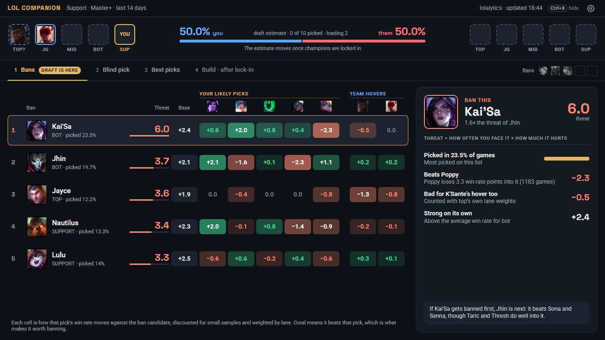
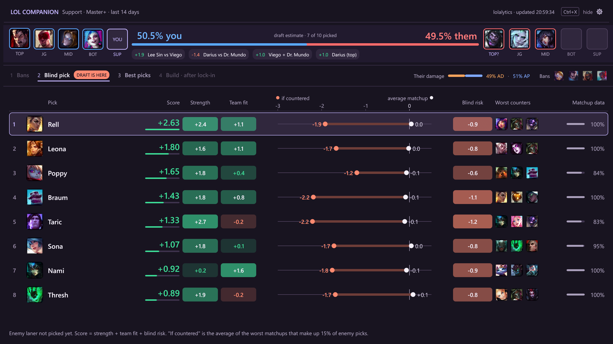
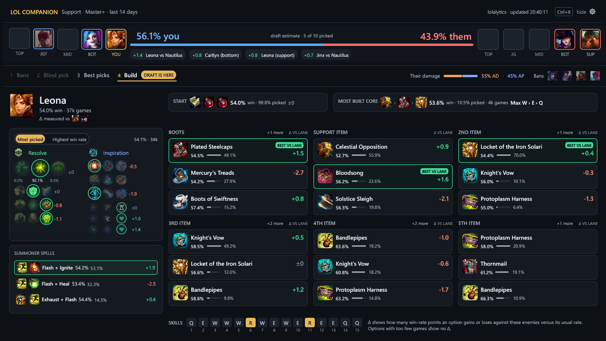
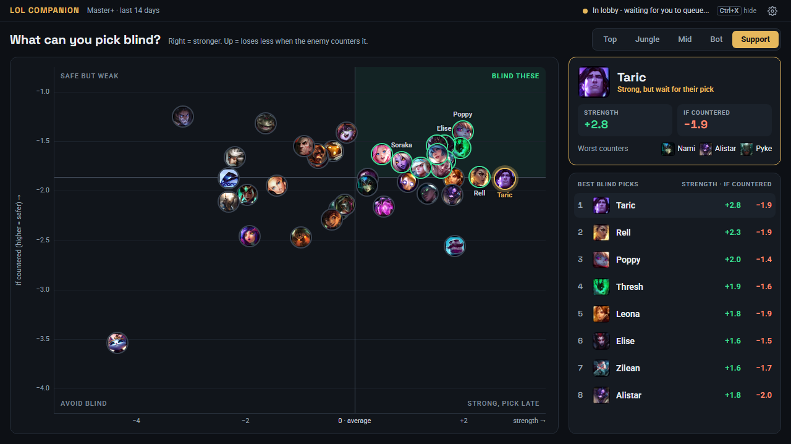
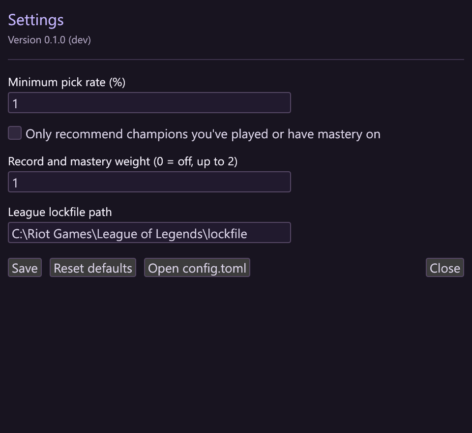

<div align="center">


# LoL Companion

Draft recommendations and matchup-specific builds for League of Legends on Windows.

[](https://github.com/angelotc/lol-companion/releases/latest/download/LoLCompanion-win-Setup.exe)&nbsp;&nbsp;
[](https://github.com/angelotc/lol-companion/releases/latest/download/LoLCompanion.zip)&nbsp;&nbsp;
[](#use)

</div>

---

Recommendations use:

- **Master+ Lolalytics data** for champion strength, matchups, synergies, and builds.
- **Your current draft** for picks and bans that fit your team and account for the opponents you know.
- **Your champion masteries and recent match history** to factor your experience into pick rankings.


## Install

- Run the **Windows installer** to install for your account without admin rights and get automatic updates.
- Extract the **portable ZIP** and run `LoLCompanion.exe`. Update portable copies manually.

The app is unsigned. If Windows shows an unrecognized app warning, select **More info → Run anyway**.

## Use

The panel first opens at 1280×720 on the right edge of your main monitor and remembers its placement.
Drag any edge or corner to resize it at 16:9. Closing it hides it to the tray, and the next champ select
brings it back.

| Shortcut | Action |
|---|---|
| **Ctrl+X** | Toggle the panel while it or the League client has focus, or toggle the overlay in game. |
| **Ctrl+Shift+L** | Toggle the panel from any window. |

Use the tray icon to show or hide the panel, check for updates, open settings, enable Start with Windows, or quit.

### Champ select

The header shows both teams and the draft win estimate. The app switches views as the draft advances.
You can open another available view at any time. Hover a score for its sample size, or click an enemy
champion to correct a guessed lane. The step row shows bans and the enemy team's damage split.

#### Ban phase



Bans rank by how often you might face a champion and how much it threatens your likely picks and
your teammates' hovers. The detail panel explains the top ban.

#### Blind pick



While your lane opponent is unknown, picks rank by strength, team fit, and counter risk. Each row
compares the average matchup with the worst matchups that make up 15% of opponent picks. Tune the
ranking under `[blind]` in `config.toml`.

#### Best picks

Once your lane opponent is known, picks rank by strength, matchups, synergies, and your experience.
Each row adds up to its score. Click a pick to see the underlying win-rate changes. The rankings
freeze when you lock in.

#### Build



After lock-in, see runes, summoner spells, skill order, and items. Each option's Δ shows how much
better it performs against this draft than usual, in win-rate points adjusted for sample size. Hover
an option for details. Hover **+N more** to see additional items for a slot.

### In game


In borderless or windowed mode, an overlay sits along the right edge of the game without taking
focus. See your gold and remaining item options, with each item's win rate and Δ by enemy lane.
Alongside the build, see all 10 players' ranks, season records, champion stats, and recent results.

### Between games



The blind-pick explorer plots champion strength against counter risk for any role and defaults to
your most-played role. Click a champion to see its worst counters. The app preloads stats for
your usual roles and switches to your selected roles when you queue.

## Settings



Open **Settings** from the tray or the title bar gear. Saved changes apply immediately. The installed
app stores settings and advanced options in `%LOCALAPPDATA%\league-analysis\config.toml`.

| Key | Default | Purpose |
|---|---|---|
| `min_pick_rate` | 1.0 | Minimum candidate pick rate (%). Lower it for off-meta picks. |
| `comfort_only` | false | Only recommend champions you've played. |
| `[comfort]` | | `weight` (0 = off), `k`, `history`, `half_life`, `min_games`, `mastery`, `mastery_cap` |
| `[weights.<role>]` | | Per-role lane weights. |
| `[build_weights.<role>]` | | Which enemies build Δs are measured against, and their weights. |
| `build_min_games` | 20 | Ignore an enemy's Δ for an option below this many games. |
| `ingame_scale` | 1.0 | Overlay size multiplier, on top of scaling with game resolution. |
| `[odds]` | | Draft win estimate weights. |
| `record_games` | false | Save raw in-game data to one `.jsonl` per game in `recordings\` every `record_every` seconds (15 by default). |

## How picks are scored

Each candidate gets one score in win-rate points.

```
score(c) = base + Σ vs + Σ with + you + mastery

base    = shrink(wr(c) − avg_wr, games(c), k)                   × w_base
vs      = shrink(Δ(c vs enemy in lane L), games, k)             × w_enemy[L]   each known enemy
with    = shrink(Δ(c with ally in lane L), games, k)            × w_ally[L]    each ally (× 0.5 if hovered)
you     = shrink(your_wr(c) − wr(c), your_games(c), 40) × 0.5   × w_comfort   (3+ games)
mastery = min(0.15 × ln(1 + points / 1000), 1.0)                × w_comfort

shrink(δ, n, k) = δ × n / (n + k)     k = 500: a 500-game sample counts half
your games are weighted 0.5^(age / half_life), half_life = 90 days
```

- **Δ** is the normalized Lolalytics delta. It measures how much better `c` does with or against
  another champion than their individual win rates predict.
- **wr, games, avg_wr** use Master+ data for your role over the last 14 days.

| Lane weight | your lane | duo lane (bot/sup) | jungle | other |
|---|---|---|---|---|
| `w_enemy` | 1.0 | 1.0 | 0.5 | 0.3 |
| `w_ally` | – | 1.0 | 0.5 | 0.3 |

- **Ban threat** = `pick_rate × (harm to your picks + harm to each teammate's hover + strength × w_enemy)`, summed over lanes. Harm to your picks is averaged (you play one); each hover counts in full, with that teammate's own lane weights.
- **Build Δ** = `shrink((wr_option_vs − wr_vs) − (wr_option − wr), games, 300)`, hidden under 20 games (`build_min_games`).
- **Draft win estimate**: champion strength (half weight) + cross-team matchups (1.0 same lane, 0.7
  bot duos, 0.35 other) + synergy (half weight), capped 25–75%. Calibrate it on your own drafts with
  `scripts/backtest.py`, which fits `cal_a`/`cal_b` for `[odds]` in the config (the estimate then
  passes through `sigmoid(cal_a · total + cal_b)` instead of the cap).

## Data sources

| API | Used for |
|---|---|
| [League Client API](https://developer.riotgames.com/docs/lol#league-client-api) (local, read-only) | Draft, lobby, patch, match history, mastery, and public player profiles. |
| [Live Client Data API](https://developer.riotgames.com/docs/lol#game-client-api) (`127.0.0.1:2999`) | Your items, gold, and level, plus all players' champions and positions. No enemy items or timers are read. |
| [Lolalytics](https://lolalytics.com) (unofficial) | Win rates, matchups, synergies, and builds. Cached for 24 hours. |
| [OP.GG](https://op.gg) (unofficial) | Season solo queue records for each player's current champion. Cached for 6 hours. Disable with `opgg = false`. |
| [Data Dragon](https://ddragon.leagueoflegends.com) + [CommunityDragon](https://raw.communitydragon.org) | Champion, item and rune data and images |
| GitHub Releases (via [Velopack](https://velopack.io)) | Auto-updates |

Nothing is injected into the client or the game.

## Performance

Idle measurements for the original Python app and the current native Rust app on Windows 11 used a
5-second settle and a 5-second sample.

| Runtime | Processes | Working Set | Private Mem | Idle CPU (% of 1 core) |
|---|---:|---:|---:|---:|
| **Python + WebView2** *(live tree, idle)* | 8 | 149.5–309.7 MB | 580.4–641.5 MB | 7.17% |
| **Rust (`egui`)** — Out of game *(draft)* | 1 | 126.9 MB | 116.4 MB | 3.43% (`0.21%` total) |
| **Rust (`egui`)** — In game *(overlay)* | 1 | 107.1 MB | 120.5 MB | 0.00% |

## Develop

```powershell
cargo run --release                                               # live
cargo run -- --record drafts/x.jsonl                              # live + record
cargo run -- --replay drafts/x.jsonl                              # replay
cargo run -- --simulate --role support --allies jinx --enemies nautilus
cargo run -- --simulate --role support --items 3158,3109          # in-game window: build for items held
cargo run -- --simulate --role support --players                  # in-game window: players from tests/fixtures/players
cargo test
cargo build --release
cargo install --path . --force
```

To refresh all seven README screenshots on Windows, run `cargo build`, then
`powershell -File scripts/capture-readme.ps1`. The script seeds a separate preview data
folder from your existing cache and captures the app without using your live settings.

A push that changes only `README.md` skips the release build. Other pushes to `main` run
`cargo test`, build the release binary, and publish version `0.1.<run>` with the Velopack
installer, update feed, and portable ZIP.

| Path | |
|---|---|
| [src/main.rs](src/main.rs) | Entry point: `eframe` windows, deferred overlay viewport, CLI simulation/replay, hotkeys |
| [src/domain/](src/domain/) | Config (`config.toml`), LCU/live state parsing, builds, scoring, blind-pick report |
| [src/data/](src/data/) | League client (`lcu.rs`), lolalytics, Data Dragon, op.gg, HTTP/disk cache, SQLite `store.rs` |
| [src/engine/](src/engine/) | `controller.rs` (client updates → screen updates), `recommender.rs`, `views.rs` |
| [src/ui/](src/ui/) | Native `egui` views: `client_view.rs`, `explore_view.rs`, `bans_view.rs`, `picks_view.rs`, `build_view.rs`, `game_view.rs`, `settings_view.rs` |
| [src/win32.rs](src/win32.rs), [src/tray.rs](src/tray.rs), [src/images.rs](src/images.rs) | Win32 window placement/16:9 lock/hotkeys, system tray, async image cache |
